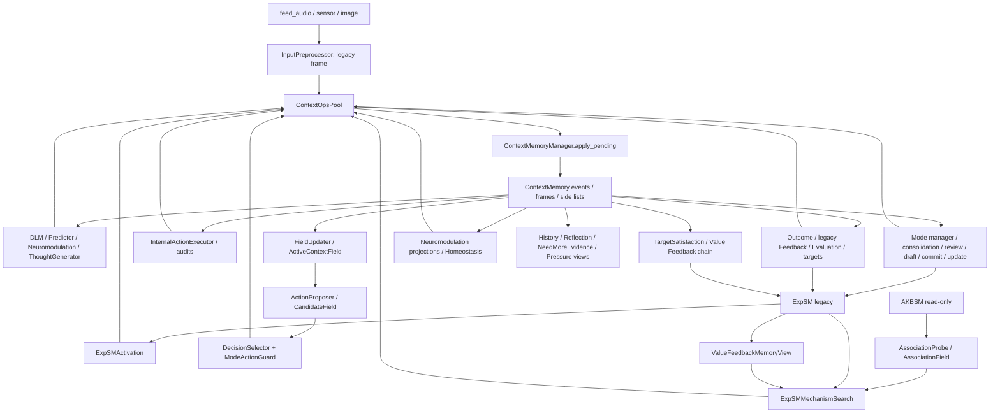
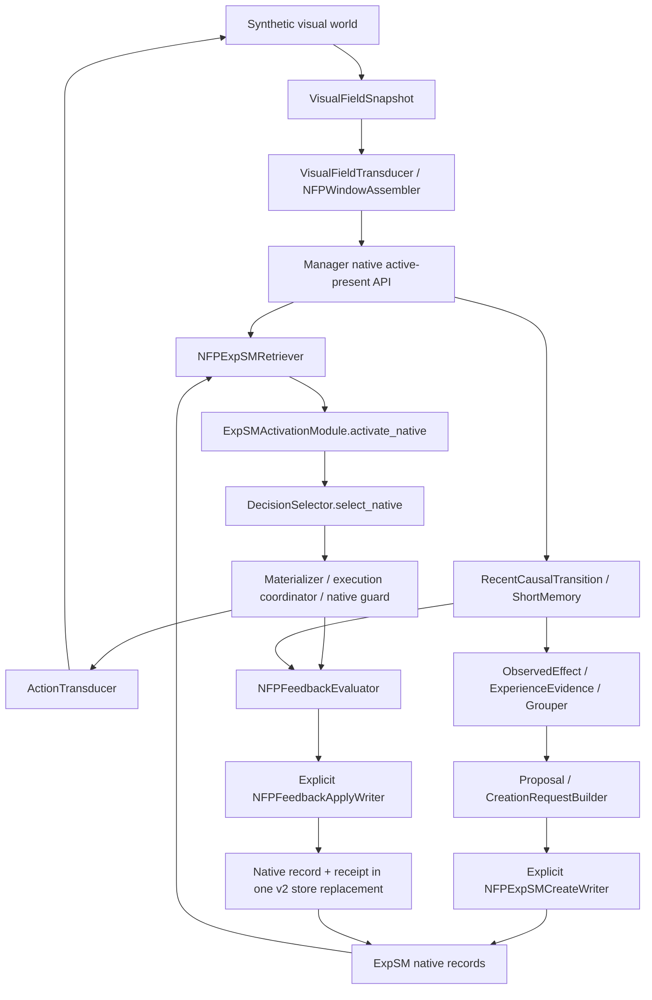

# RND-000 — Фактическая инвентаризация архитектуры RNDeM

Дата: 6 ноября 2026. Режим: локальное исследование, без изменения реализации.

## Основание и границы

**FACT.** Исследуемая папка называется `RNDeM_Prototype`; название проекта в задании и документации — `RNDeM_CLC_Prototype`. Локальные `HEAD` и `main`: `2033530f14a715855aec76df489634f9ab38e0d4`, то есть ожидаемая контрольная точка подтверждена. До работы `git status --short` показывал только `?? AGENTS.md`. Прочитан корневой `AGENTS.md`; этот ранее существовавший файл не изменён. Обращений к origin, коммитов, merge и тегов не было.

Исследование включает структуру всех 146 Python-файлов `clc`, поиск связей и целевых ролей, чтение основного runtime и ключевых реализаций/контрактов, изучение проверочных контуров. Найдены 115 `tools/verify_*.py` и 85 JSON-файлов в `scenarios` вместе со snapshots. Это количество файлов, а не количество успешно выполненных тестов. Исторические логи не использованы как доказательство текущей работоспособности. Проверки перечислены в приложении; полная регрессия не заявляется.

Обозначения: **FACT** — подтверждено кодом/проверкой; **INFERENCE** — вывод из указанных фактов; **OPEN QUESTION** — требуется решение. Статус относится к указанной функции, а не к полноте целевой архитектурной роли:

- `RUNTIME_ACTIVE`: вызов прослеживается из текущего `_run_tick`; он может быть условным, возвращать пустой результат или блокироваться policy.
- `INTEGRATED`: есть реальные связи вне основного CLC, в том числе явно указанная изолированная цепочка.
- `ISOLATED`: самостоятельный механизм/проверочный контур; отсутствие подключения к CLC отмечено отдельно.
- `PARTIAL`: реализована лишь часть целевой роли.
- `NOT_IMPLEMENTED`: соответствующая функция в текущем исследованном дереве не обнаружена. Это не утверждение об иных ветках или истории проекта.

**Главный вывод — INFERENCE.** Существуют два уровня: работающий последовательный CLC на legacy-представлениях и существенная NFP-native цепочка, реализованная и проверяемая отдельно. Поэтому неверны оба утверждения: «натуральных NFP ещё нет» и «натуральный непрерывный runtime уже собран». Основания: `CLCRuntime._run_tick`, `InputPreprocessor`, `clc.patterns.model`, native retrieval/execution/Feedback и их verifiers ниже.

## A. Компонентная инвентаризация

Все описания реализации в таблицах — **FACT**; интерпретация соответствия целевой роли вынесена в пробелы или явно обозначена.

**FACT: структура проекта.** `main.py` запускает изолированный demo; `clc/` содержит реализацию; `Memory/` — данные и отдельные CRUD utilities; `scenarios/` — JSON fixtures, regression snapshots и synthetic world support; `tools/` — исполняемые verifiers/audits; `docs/` — контракты, design/ADR и архитектурные карты. Отдельного каталога обычных pytest-тестов нет: основная проверочная инфраструктура находится в `tools/`, в том числе unittest-классы. Примеры контрактов: `docs/natural_pattern_data_contract.md`, `docs/runtime_tick_phase_map.md`; их наличие не доказывает, что описанная целевая интеграция уже выполнена.

### A1. Runtime, представления и передача

| Компонент | Архитектурная роль | Реальная реализация | Статус | Зависимости | Доказательства | Пробелы |
|---|---|---|---|---|---|---|
| CLCRuntime | Организация текущего цикла | `feed_audio/sensor/image` ставят вход и сразу вызывают `_run_tick(tick)`, 12 последовательных фаз | RUNTIME_ACTIVE | Практически все legacy-модули | [runtime](../clc/runtime/clc_runtime.py), `__init__`, `feed_*`, `_run_tick`; [main](../main.py) | Собственного планировщика/тактов нет; tick задаёт вызывающий код |
| ПЖК / Сердце | Самостоятельный жизненный цикл | Есть состояние режима, переходы active/consolidation/recovery; автономный источник тактов не найден | PARTIAL | SystemState, SystemModeManager | [mode manager](../clc/system/system_mode_manager.py), `run`; `demo_run/_run_demo_scenarios` | Режимы не реализуют полноценный жизненный цикл и собственное время |
| ContextOperation + OperationMarker | Управляющие сообщения | Замороженная оболочка с op_id, marker, tick, source_module, target и payload; рекурсивная заморозка mappings/sequences | RUNTIME_ACTIVE | Enum маркеров, производители | [operations](../clc/core/operations.py), [markers](../clc/core/markers.py) | target не делает очередь маршрутизатором; payload не единый NFP-контракт, произвольные объекты не глубоко замораживаются |
| ContextOpsPool / Manager | Передача результатов в контекст | FIFO deque; `push/extend/drain`; менеджер применяет операции и retention | RUNTIME_ACTIVE | ContextMemory | [pool](../clc/context/context_ops_pool.py), [manager](../clc/context/context_memory_manager.py), `apply_pending` | Один канал и один получатель, без подписок, приоритетного планирования и обратного давления |
| Магистраль / Квадрат | Многоканальный поток NFP/маркеров | Отдельного транспорта не найдено; очередь и phase calls покрывают часть обмена | PARTIAL | ContextOperation, ContextOpsPool, прямые вызовы | Те же файлы; `CLCRuntime._phase_00`–`_phase_10` | Нельзя считать существующую очередь готовой многоканальной Магистралью |
| Legacy NFPFrame / ContextWindow | Текущий материал CLC | Mapping activation ID → float; frame tick/origin/source/ttl/decay; окно хранит ссылки frame_ids | RUNTIME_ACTIVE | PatternRegistry, ContextMemory | [core/nfp](../clc/core/nfp.py), [window](../clc/context/window.py), `ContextMemory.build_window` | Не равны натуральным типам с topology и modality |
| Натуральные NFPFrame/Window | Натуральные пространственно-временные активации | Неизменяемые values, modality/origin/topology, active_tick/provenance; совместимость и строгий порядок ticks в окне | INTEGRATED, вне CLC | Transduction, memory, native experience | [model](../clc/patterns/model.py), `NFPFrame`, `NFPWindow`; [substrate verifier](../tools/verify_minimal_activation_pattern_substrate.py) | Основной `_run_tick` их не обрабатывает |
| NFPSequence / PatternMoment | Длинная последовательность / мультимодальный момент | Sequence группирует совместимые окна; Moment объединяет кадры одного tick | ISOLATED | NFPFrame/Window | Тот же `model.py`, `NFPSequence`, `PatternMoment` | Нет исполняющего потокового потребителя; Sequence допускает перекрывающиеся окна, не требует сплошного времени |
| Similarity / Reactivation | Сходство и внутренний повтор | Средняя абсолютная дистанция совместимых кадров/окон; реактивация с INTERNAL_REACTIVATION и ссылкой на источник | INTEGRATED, вне CLC | Natural model | [similarity](../clc/patterns/similarity.py), [reactivation](../clc/patterns/reactivation.py) | Реактивация кадра не самостоятельная WL; нет общей sequence similarity |
| InputPreprocessor | Сенсорный вход CLC | audio frequencies, RGB и внутренние датчики → legacy activation IDs → RAW_INPUT_WRITE | RUNTIME_ACTIVE | PatternRegistry | [preprocessor](../clc/preprocessing/input_preprocessor.py), `audio/image/sensor` | Это не VisualFieldTransducer; датчики CPU/памяти получают числа от вызывающего кода |
| VisualFieldTransducer / assembler | Натуральная сенсорная трансдукция | Scalar-field snapshot → VISUAL EXTERNAL_SENSORY frame; sliding window совместимых внешних кадров | INTEGRATED, вне CLC | Natural model, synthetic worlds | [visual](../clc/transduction/visual.py), [windowing](../clc/transduction/windowing.py); [verifier](../tools/verify_first_natural_pattern_transduction.py) | Только реализованный visual boundary; natural audio/internal transducer не найден |
| ActionTransducer | Внешний A-NFP → actuator | Только ACTION + ACTION_GENERATED, topology `(2,)`; числовой сигнал с непрозрачной ссылкой на кадр | INTEGRATED, вне CLC | NFPFrame, ActuatorSignal | [motor](../clc/actuation/motor.py), `transduce`; [closed-loop verifier](../tools/verify_first_closed_loop_action_consequence.py) | Двухкомпонентный синтетический actuator, не общий исполнитель внешней среды |
| Remembered action coordinator | Guarded исполнение извлечённого опыта | Проверяет актуальность tick, свободный causal slot, материализует новый ACTION/UUIDv4, guard → transducer → world → observation | INTEGRATED, вне CLC | SelectedNFPExpSMExperience, manager, ShortMemory optional | [execution](../clc/actuation/remembered_action_execution.py), `NFPActionOccurrenceMaterializer.materialize`, `NFPRememberedActionExecutionCoordinator.execute`; [verifier](../tools/verify_nfp_remembered_action_guarded_execution.py) | Явно вызываемый serialized coordinator; не владеет retrieval/Feedback, не работает в `_run_tick` |

### A2. Память, опыт, persistence

| Компонент | Архитектурная роль | Реальная реализация | Статус | Зависимости | Доказательства | Пробелы |
|---|---|---|---|---|---|---|
| ContextMemory | Оперативный контекст/история CLC | События, raw/thought frames, marker-specific side lists, ToneState, query windows | RUNTIME_ACTIVE | Manager, retention | [context](../clc/context/context_memory.py), `add_frame/add_event/build_window/apply_retention/apply_side_list_retention` | Оперативная история процесса, не durable Chronicle |
| Native active-present API | Натуральное «сейчас» | Manager отдельно держит текущее sensory window, ACTION, один pending transition; завершает только на ожидаемом T+1 | INTEGRATED, вне CLC | Pending/RecentCausalTransition | [manager](../clc/context/context_memory_manager.py), `observe_external_sensory_window/observe_action_frame/expire_pending_if_overdue`; [causal](../clc/context/causal_transition.py) | Не пишет эти объекты в legacy side lists; visual-only causal validation; нет нескольких открытых действий |
| ShortMemory | Недавние сырые наблюдённые переходы | In-process tuple RecentCausalTransition, max_entries/max_age_ticks, remember/prune, порядок времени | INTEGRATED, вне CLC | Native causal transition | [short](../clc/context/short_memory.py); [verifier](../tools/verify_nfp_context_short_memory.py) | Не создаётся CLCRuntime; вставка завершённого перехода явная; 3 несовпадения verifier зафиксированы ниже |
| Retention / diagnostics | Ограничение оперативной истории | Ограничения events и отдельных side lists, pruning и метрики; field TTL/decay отдельно | RUNTIME_ACTIVE | ContextMemory/Manager | [retention](../clc/context/context_retention_policy.py), [diagnostics](../clc/diagnostics/retention_diagnostics.py), `ActiveContextField.decay_all` | Не тождественны консолидации или долговременному обобщению |
| PatternRegistry | Стабильные legacy ID и семантические метаданные | pat_* IDs, debug names, semantic_class/tags/learnability, manifest persistence | RUNTIME_ACTIVE | pattern_manifest.json | [registry](../clc/core/pattern_registry.py), `id/register_if_missing/save` | IDs и теги участвуют в старой логике; регистрация может писать manifest |
| PatternStore | Чтение legacy паттернов | `.nfp` загрузка, activation values, frame/window similarity; in-memory fallback | RUNTIME_ACTIVE | AKBSM/DB, registry | [store](../clc/storage_models/pattern_store.py), `load/find_similar_to_window/_window_activation_values` | Окно агрегирует max по активациям, теряя порядок; не native NFPWindow |
| ExpSMAdapter + fallback | Legacy operational retrieval | Чтение experience/reflexes, match по PatternStore, reload; при нехватке разрешимых записей добавляет demo fallback в RAM | RUNTIME_ACTIVE | ExpSM JSON, PatternStore | [adapter](../clc/storage_models/expsm_adapter.py), `load/_match_records/_install_demo_fallback_records_if_needed`; [fake](../clc/storage_models/fake_expsm.py) | Загрузка native JSON не означает native matching; fallback необходимо отличать от приобретённого опыта |
| Legacy experience chain | Формирование опыта CLC | Outcome → causal trace → learnability → candidate buffer/group → consolidation candidates | RUNTIME_ACTIVE | ContextMemory, field, registry | [builder](../clc/experience/experience_candidate_builder.py), [trace](../clc/experience/causal_trace.py), [filter](../clc/experience/learnability_filter.py), [buffer](../clc/experience/experience_candidate_buffer.py), [groups](../clc/experience/candidate_group.py); фаза 06 | Правила и ссылки legacy; это другая цепочка, чем native three-axis grouping |
| Native effects/evidence/grouping | ShortMemory → кандидат ExpSM | Signed endpoint delta; ExperienceEvidence из перехода; независимое сравнение context/action/effect, ambiguity/duplicate, min_support и proposal | INTEGRATED, вне CLC | Native windows/actions/transitions | [effects](../clc/experience/effects.py), [evidence](../clc/experience/evidence.py), [grouping](../clc/experience/grouping.py); [verifier](../tools/verify_short_memory_expsm_evaluation.py) | Proposal не запись; representative — первое evidence, не выученное обобщение; endpoint delta не доказывает причинность |
| Native persistent representation | Структура постоянного опыта | Serialized context/action/effect, operational metadata, creation metadata, typed adapter: legacy/native/malformed/unsupported | INTEGRATED, вне CLC | ExperienceEvidence/proposal | [representation](../clc/experience/expsm_representation.py), `ExpSMRecordAdapter.parse`, `ExpSMRecordCreationRequestBuilder.build`; [verifier](../tools/verify_persistent_nfp_expsm_representation.py) | Не сохраняет occurrence как живой кадр; полная история sensor provenance не переносится |
| NFP-native CREATE | Явная запись нового опыта | Typed validation, allow_expsm_commit, writer-owned numeric max+1 ID, strict fresh load/write/readback, reconciliation | INTEGRATED, вне CLC | Transaction, creation request, policy | [create](../clc/experience/expsm_native_create.py), `NFPExpSMCreateWriter.create/reconcile_expsm_readback_failure`; [verifier](../tools/verify_nfp_expsm_policy_gated_create.py) | READBACK_FAILED — неопределённость для caller, не разрешение безусловного повтора; общего CREATE dedup ledger нет |
| Native retrieval / activation / selection | Контекст → применимый опыт | Read-only mixed-store retrieval, structural similarity/threshold → existing operational activation/top-N → typed selection | INTEGRATED, вне CLC | Representation, ExpSMActivationModule, DecisionSelector | [retrieval](../clc/expsm/nfp_operational_retrieval.py), `NFPExpSMRetriever.retrieve`; [activation](../clc/expsm/expsm_activation_module.py), `activate_native`; [selector](../clc/action/decision_selector.py), `select_native`; [verifier](../tools/verify_nfp_expsm_operational_retrieval.py) | Основной runtime вызывает `run/select`, а не эти native API; выбор ещё не ACTION occurrence |
| Native Feedback evaluation | Проверка предсказанного эффекта | Pure сравнение predicted/actual signed effect, source/TargetCore/occurrence binding, HIT/MISS и отдельные pending/ineligible/mismatch результаты | INTEGRATED, вне CLC | Execution result, RecentCausalTransition | [evaluator](../clc/expsm/nfp_native_feedback.py), `NFPFeedbackEvaluator.evaluate`; [verifier](../tools/verify_nfp_native_feedback_evaluation.py) | Это надёжность предсказания, не полезность/награда и не право записи |
| Native Feedback apply / Stage 2 | Exact-source update и durable replay | Запись operational update вместе с receipt в envelope v2; event key source ID + UUIDv4; evidence digest и occurrence index; duplicate/conflict/stale handling | INTEGRATED, вне CLC | Transaction, policy allow_expsm_update, TargetCore | [apply](../clc/expsm/nfp_native_feedback_apply.py), `NFPFeedbackApplyWriter.apply/reconcile_nfp_feedback_readback_failure`; [replay verifier](../tools/verify_nfp_native_feedback_replay_idempotency.py) | Автоматической runtime-подписки нет; защита повторного Feedback не предотвращает повторное физическое действие |
| Stage-1 shared persistence | Сериализация authoritative ExpSM writers | Reentrant per-resolved-path RLock, stable `.lock` flock, fresh load под lock, temporary file + fsync + replace, parent fsync best effort; legacy/v2 normalization, запрет downgrade | INTEGRATED; используется runtime writers | Семь writer implementations, Linux fcntl | [transaction](../clc/consolidation/expsm_store_transaction.py), `mutation/load_for_mutation_strict/write_complete_store`; [stage1 verifier](../tools/verify_expsm_persistence_stage1.py), `WRITERS` | Не транзакция всей RNDeM, не общая защита AKBSM/WL/drafts; portability ограничена fcntl |
| ExpSMCRUD | Ручное управление опытом/reflexes | CRUD, counters, experience↔reflex, mutation decorator со shared transaction | INTEGRATED, вне CLC как CRUD API | Transaction | [CRUD](../Memory/ExpSM/Exp_CRUD.py), `authoritative_mutation`, `ExpSMCRUD`; `verify_expsm_persistence_stage1.py` | Сам по себе CRUD не когнитивное обучение; основной runtime пользуется специализированными writers |
| AKBSM | Ассоциативные знания | Read-only adapter edges, related patterns, bounded multi-hop search; NoveltyDLM + target association probe/field → mechanism search | RUNTIME_ACTIVE, чтение | PatternStore, evaluation targets | [adapter](../clc/storage_models/akbsm_adapter.py), `find_associations`; [probe](../clc/akbsm/akbsm_association_probe.py), `run`; [field](../clc/akbsm/akbsm_association_field.py); [updater](../clc/akbsm/akbsm_association_field_updater.py) | Граф не обучается текущим CLC; идентификаторы legacy |
| AKBSM CRUD / draft lifecycle | Управление графом и обсуждение proposals | CRUD файлов/edges; отдельно metadata-only provider, review states/controller, placement adapter | ISOLATED относительно runtime-записи | Policy, probe evidence, temporary metadata | [AKBSM CRUD](../Memory/AKBSM/AKBSM_CRUD.py); [provider](../clc/runtime/akbsm_draft_proposal.py), [lifecycle](../clc/runtime/akbsm_proposal_lifecycle.py), [adapter](../clc/runtime/akbsm_proposal_contextmemory_metadata.py); `tools/verify_akbsm_draft_proposal_transition_controller_scenarios.py` | Во всех стандартных профилях allow_akbsm_write=false; proposal flag default=false; metadata не даёт write authority |
| Temporary metadata / diagnostic wrapper | Локальное временное служебное состояние | Собственный placement storage, TTL/expiration, read-only observation/diagnostics, explicit harness authority | ISOLATED | AKBSM proposal metadata optional | [placement](../clc/runtime/context_temporary_metadata.py), [observation](../clc/runtime/context_temporary_metadata_observation.py), [diagnostics](../clc/runtime/context_temporary_metadata_diagnostics.py), [tick wrapper](../clc/runtime/context_temporary_metadata_tick_diagnostics.py) | Несмотря на названия, wrapper не включён в `_run_tick`, storage не является native sensory memory или Доской |
| WL | Ограниченная самостоятельная запись/реактивация | `WLCRUD` читает/пишет/дописывает обычный WL.txt | PARTIAL; CRUD изолирован | Текстовый файл | [WL CRUD](../Memory/WL/WL_CRUD.py); `CLCRuntime.debug_print_memory_summary` TODO | Целевая NFP self-space функция и интеграция отсутствуют; имеющийся CRUD не следует выдавать за неё |
| Chronicle / память процессов | Долговременная история и состояние процессов | Существуют ContextMemory.events, causal traces, audit summaries и technical Feedback receipts | PARTIAL | In-process контекст, ExpSM receipts | `ContextMemory.add_event`; `CausalTrace`; `NFPFeedbackApplyWriter` | Отдельной durable Chronicle/памяти возобновляемых процессов не найдено; receipt не когнитивная хроника |
| DTF / TFH data | Старые описания данных/типов | `DTF.json` содержит img/aud/sen; `DTF_TFH.json` содержит DTF_type/type_proc/edge_type/ExpSM/axes_schema | ISOLATED как данные | JSON в Memory | [DTF](../Memory/DTF.json), [TFH](../Memory/DTF_TFH.json); поиск `DTF/TFH` в `clc` не дал ссылок | Загрузчик этих файлов в текущем CLC не найден; наличие данных не означает работающую подсистему |
| Временная память / Занозы | Более долгие недавние обобщения / открытые вопросы | Есть transient grouping и observational NeedMoreEvidenceSignal, но целевого хранилища/жизненного цикла нет | NOT_IMPLEMENTED как целевые подсистемы | Возможные заготовки перечислены слева | [grouping](../clc/experience/grouping.py), [need-more-evidence](../clc/evaluation/need_more_evidence_signal.py); поиск по дереву `clc` | Ни TTL metadata, ни ShortMemory не реализуют эту целевую роль автоматически |

### A3. Обработка, оценивание, координация и защита

| Компонент | Архитектурная роль | Реальная реализация | Статус | Зависимости | Доказательства | Пробелы |
|---|---|---|---|---|---|---|
| DLM | Специализированная обработка | BaseDLM.run → list ContextOperation; Rhythm — изменения 440 Hz; Novelty — image similarity/AKBSM; Risk — ExpSM/fallback; InternalState — пороговые sensor IDs | RUNTIME_ACTIVE | Memory, registry/adapters | [base](../clc/dlm/base_dlm.py), [rhythm](../clc/dlm/rhythm_dlm.py), [novelty](../clc/dlm/novelty_dlm.py), [risk](../clc/dlm/risk_dlm.py), [internal](../clc/dlm/internal_state_dlm.py); фаза 01 | Эвристики legacy, не универсальные native DLM; самостоятельного DLS не найдено |
| Prediction / Outcome | Ожидания и наблюдение | Predictor строит legacy predictions из labels/ExpSM; OutcomeEvaluator после delay сопоставляет patterns/effects/tone и выдаёт confirmed/partial/failed/expired/inconclusive | RUNTIME_ACTIVE | Legacy windows, field, ToneState | [predictor](../clc/prediction/simple_future_state_predictor.py), [outcome](../clc/outcome/outcome_evaluator.py), `run` | Частичная функция ЭХО; нет общего реестра длительных открытых ожиданий и независимого native prediction engine |
| ThoughtGenerator | Внутренние паттерны | Правила labels/prediction/field/tone → legacy SELF_GENERATED_THOUGHT; эффекты могут вызвать новые мысли | RUNTIME_ACTIVE | ContextMemory, ActiveContextField | [thought](../clc/thought/thought_generator.py), `run/run_effects`; фазы 01/04 | Самогенерация не равна внешнему свидетельству и не подключает WL |
| ActiveContextField / FieldUpdater | Текущая активность | Проекция событий/кадров, reinforcement/set/max, source event refs, TTL/decay/suppress | RUNTIME_ACTIVE | ContextMemory, registry | [active field](../clc/field/active_context_field.py), [updater](../clc/field/field_updater.py), `update_from_memory` | Поле — производное оперативное состояние, не долговременная память и не Доска переговорки |
| Evaluation / targets | Многомерное оценивание | usefulness/harmfulness/need/want/avoid/safety/priority → EvaluationField → target observations | RUNTIME_ACTIVE | Tone/events/field, rule tables | [signals](../clc/evaluation/evaluation_signal_module.py), [field](../clc/evaluation/evaluation_field.py), [updater](../clc/evaluation/evaluation_field_updater.py), [targets](../clc/evaluation/evaluation_target_observer.py) | Многокритериальные механизмы есть; отдельного общего Сумматора целевой архитектуры нет |
| ActionProposer / candidate field | Поводы к внутреннему действию | Предлагает известные action IDs из активных patterns/tone/memory signals; field хранит и подавляет/ослабляет кандидаты | RUNTIME_ACTIVE | ActiveContextField, ContextMemory | [proposer](../clc/action/action_proposer.py), [candidate field](../clc/action/action_candidate_field.py), `propose/decay_all/suppress` | Частично напоминает пул поводов, но не общий пул задач/долгих процессов |
| DecisionSelector / scoring | Выбор действия | Guard-adjusted top candidates, фиксированная формула confidence/urgency/activation/risk/cost + memory terms; threshold/cooldown, INTERNAL_DECISION | RUNTIME_ACTIVE; native API отдельно INTEGRATED | CandidateField, ModeActionGuard | [selector](../clc/action/decision_selector.py), `select/select_native`; [scoring](../clc/action/action_scoring.py), `score_breakdown` | Legacy и native competition различаются: native select выбирает max activation, без полной legacy guard/scoring цепочки |
| InternalActionExecutor | Внутренние A-NFP-подобные действия | Из выбранных action IDs выдаёт INTERNAL_ACTION_EFFECT, tone delta, requests/thought patterns; повторная mode guard проверка | RUNTIME_ACTIVE | Decisions, SystemState, ModeActionGuard | [executor](../clc/action/internal_action_executor.py), `run`, action handlers | Это разрешённые внутренние эффекты, не вызов ActionTransducer и не внешний actuator |
| Neuromodulation / Homeostasis | Регуляция состояния | ToneState: integrity/stability/curiosity/risk_sensitivity/fatigue/tension/satisfaction/pain; проекции событий и rule-based сдвиги | RUNTIME_ACTIVE | ContextMemory, outcomes, field | [tone](../clc/neuromodulation/tone_state.py), [neuromodulation](../clc/neuromodulation/neuromodulation_module.py), [homeostasis](../clc/homeostasis/homeostasis_module.py); фазы 01/04/08/09 | Параметрическая регуляция; общего распределителя вычислительных ресурсов нет |
| Консолидация legacy | Закрепление опыта | pressure → mode processor → review → draft enrichment/relevance/filtering → draft writer → commit gate → commit/update writers → adapter reload | RUNTIME_ACTIVE, записи условны | Policy, drafts, ExpSM, semantic metadata | [pressure](../clc/consolidation/consolidation_pressure_module.py), [processor](../clc/consolidation/consolidation_mode_processor.py), [review](../clc/consolidation/memory_write_review_module.py), [draft](../clc/consolidation/memory_draft_writer.py), [gate](../clc/consolidation/draft_commit_gate.py), [commit](../clc/consolidation/expsm_commit_writer.py), [update gate](../clc/consolidation/expsm_update_review_gate.py), [update](../clc/consolidation/expsm_update_writer.py); фазы 02/05 | Это не автоматическая native CREATE цепочка; draft-файл и authoritative ExpSM имеют разные гарантии записи |
| ExpSM activation/mechanism search | Использование опыта в действии | Legacy pattern intersection → activation; targets + AKBSM associations + value memory → mechanism search; proposer делает action candidates | RUNTIME_ACTIVE | ExpSM, fields, ValueFeedbackMemoryView | [activation](../clc/expsm/expsm_activation_module.py), [mechanisms](../clc/expsm/expsm_mechanism_search.py), `run`; `ActionProposer.propose` | Mechanism search находится после выбора: новый результат влияет на следующий tick |
| Legacy ExpSM feedback / observers | Подкрепление надёжности опыта | Outcome feedback связан с source experience/activation/decision; similarity/competition observations | RUNTIME_ACTIVE, обновление условно | Decisions/outcomes/ExpSM transaction | [feedback](../clc/expsm/expsm_outcome_feedback.py), `run/_apply_feedback`; [similarity](../clc/expsm/expsm_similarity_observer.py), [competition](../clc/expsm/expsm_competition_observer.py) | Не native Feedback evaluator/apply; у OutcomeFeedback нет MemoryMutationPolicy аргумента |
| Value Feedback | Оценка полезности относительно цели | Satisfaction → candidate → review → policy-gated update → memory view → target-specific mechanism scoring | RUNTIME_ACTIVE, запись условна | Evaluation targets, ExpSM, policy | [satisfaction](../clc/evaluation/target_satisfaction_observer.py), [candidate](../clc/evaluation/value_feedback_candidate_builder.py), [review](../clc/evaluation/value_feedback_review_gate.py), [writer](../clc/evaluation/value_feedback_update_writer.py), [view](../clc/evaluation/value_feedback_memory_view.py); фаза 07 | Отличать полезность от hit/miss точности предсказания |
| Audits / reflection / pressure | Наблюдение за решениями | DecisionAudit/GuardAudit/CycleSummary; history → reflection candidates → need-more-evidence → review → policy pressure → review | RUNTIME_ACTIVE, диагностический контур | ContextMemory summaries, in-process views | [decision audit](../clc/action/decision_audit_observer.py), [guard audit](../clc/action/action_guard_audit_observer.py), [summary](../clc/action/decision_cycle_summary_observer.py), `clc/evaluation/decision_cycle_history_view.py`, `reflection_candidate_builder.py`, `reflection_review.py`, `policy_pressure.py`, `policy_pressure_review.py`; фазы 04/10 | Выполнение диагностики не означает её влияния на поведение; самостоятельных процессов reflection нет |
| Mode C advisory | Будущая связь pressure → memory gate | Metadata-only payload/provider, policy flag default=false, apply_now=false | ISOLATED | PolicyPressureReview, policy | [advisory](../clc/runtime/mode_c_advisory.py), `from_policy_pressure_review` | В gates не подключён |
| Guards / mutation policy | Ограничения действия и записи | ModeActionGuard, mode cleanup, review gates, safe_demo/draft_only/mutating_memory; native guard требует active mode/current tick | RUNTIME_ACTIVE; native branch вне CLC | SystemState, policy | [guard](../clc/system/mode_action_guard.py), [cleanup](../clc/system/mode_transition_cleanup.py), [policy](../clc/runtime/memory_mutation_policy.py) | Это существующие полезные ограничения, но не независимая КАПРИЗ; политика не охватывает все файловые writers |
| ДАР | Распределение активности/ресурсов | Есть ranking/decay, modes, tone pressure, локальные лимиты probes/evaluations | PARTIAL | Fields, mode/selection | `ActiveContextField.decay_all`, `DecisionSelector.select`, `AKBSMAssociationProbe.run`, `EvaluationSignalModule.run` | Отдельного budget scheduler, fairness и распределения ресурсов модулям нет |
| Пул задач / менеджеры процессов | Ожидающие поводы и организация процессов | Есть очередь операций, action candidates и статическая фазовая оркестрация | PARTIAL | Runtime/fields/queue | `ContextOpsPool`, `ActionCandidateField`, `_run_tick` | Нет task lifecycle, ownership, resume/cancel и независимой организации модулей |
| Переговорки / Доска / Резолюция | Длительная совместная обработка | Отдельных session/workspace/result lifecycle контрактов не найдено | NOT_IMPLEMENTED | Возможные заготовки: context/fields/proposals | Структура `clc`, `_run_tick`, `ContextMemory`, `ContextTemporaryMetadataPlacement` | Нельзя переименованием объявить общий context переговоркой, decision — полноценной резолюцией |
| ЭХО / КАПРИЗ | Открытые ожидания / независимая защита | Ожидания частично покрыты Prediction/Outcome и pending causal slot; защита — guard/policy/review | PARTIAL для ролей | См. соответствующие строки | `OutcomeEvaluator.run`, `ContextMemoryManager.observe_*`, `ModeActionGuard`, `MemoryMutationPolicy` | Долгоживущей общей ЭХО и независимой КАПРИЗ не обнаружено |

## B. Карта текущих взаимодействий

### B1. Подтверждённый основной CLC

**FACT.** Карта ниже восстановлена по вызовам в `CLCRuntime`, а не по импортам. Почти все стрелки producer → контекст проходят через ContextOperation → ContextOpsPool → ContextMemoryManager.apply_pending. Поля и runtime-only views обновляются прямыми вызовами.

**FACT.** Стрелка Outcome → ExpSM — legacy `ExpSMOutcomeFeedback`, не автоматический `NFPFeedbackApplyWriter`. Стрелка consolidation → ExpSM условна; mode/policy/review могут запретить запись. Reflection/pressure не возвращаются в selector/gates. Evidence: `_phase_05/06/07/10`, `memory_mutation_policy.py`, `mode_c_advisory.py`.

### B2. Подтверждённая NFP-native цепочка вне `_run_tick`

**FACT.** Это композиция существующих API в verifiers, не самостоятельный сервис и не утверждение об одном production orchestration entry point. `tools/verify_nfp_remembered_action_guarded_execution.py`, `verify_nfp_expsm_operational_retrieval.py`, `verify_nfp_native_feedback_evaluation.py`, `verify_nfp_native_feedback_apply.py`, `verify_nfp_native_feedback_replay_idempotency.py` проверяют соответствующие связи. ShortMemory и consequence observation в coordinator опциональны; completed transition также может быть возвращён caller для явной вставки.

### B3. Отсутствующие связи и границы

| Связь | Фактическое положение | Доказательство |
|---|---|---|
| Собственный heartbeat → `_run_tick` | Нет; tick поступает извне через feed или scenario runner | `feed_*`, `_run_demo_scenarios`, `scenario_runner._run_inputs` |
| `feed_image` → VisualFieldTransducer | Нет; идёт через legacy preprocessor | `InputPreprocessor.image`, `CLCRuntime.feed_image` |
| `_run_tick` → native window/ShortMemory/retrieval/execute/Feedback | Вызовов нет; импорты native зависимостей могут происходить транзитивно | `clc_runtime.py`, `DecisionSelector.select` vs `select_native`; сбой import-isolation verifier |
| Native execution → автоматический Feedback apply | Нет, evaluator и writer вызываются явно | `NFPRememberedActionExecutionCoordinator.execute`, `NFPFeedbackEvaluator`, `NFPFeedbackApplyWriter` |
| Reflection/pressure → поведение / memory gate | Нет; runtime stores views, Mode C default off и не подключён | `_phase_10`, `ModeCMemoryGateAdvisoryProvider` |
| AKBSM probe → graph writer | Нет; read-only probe, proposals только отдельный harness | `AKBSMAssociationProbe`, `AKBSMDraftProposalProvider`; policy profiles |
| WLCRUD → NFP reactivation / CLC | Нет | `WL_CRUD.py`, runtime TODO |
| Общий транспорт → независимые процессы/переговорки | Не найден | `ContextOpsPool` только FIFO к manager; статический runtime call graph |

### B4. Текущий `_run_tick()` по фазам

**FACT.** Источник истины: `clc/runtime/clc_runtime.py: CLCRuntime._run_tick` и тела `_phase_*`. `runtime_phase_map.py` — описательный контракт, не исполняемый scheduler.

| Фаза | Что реально вызывается | Влияние на уже выбираемое действие |
|---|---|---|
| 00 | Commit pending input + retention | Вход доступен этому tick |
| 01 | DLM → commit; prediction → commit; tone → commit; thoughts → commit, если начальный mode active/recovery | До выбора |
| 02 | Field refresh/decay, ExpSM activation, pressure, update review, промежуточные commits/refresh | До выбора |
| 03 | Propose, candidate decay, `select` с guard | Единственная текущая точка выбора |
| 04 | Если decision есть: commit decision, audits/summary/competition, internal executor, effects projections | После выбора |
| 05 | Mode transitions/cleanup; consolidation processor, review, draft, commit gate, commit/update writers; reload и similarity observer | После выбора |
| 06 | Если active_processing и текущий mode не consolidation: outcome, legacy Feedback, evaluation/targets, AKBSM probe/field, mechanism search, experience builder/buffer | Новые mechanism results — материал следующих ticks |
| 07 | Target satisfaction → value candidates → review → writer → reload/field | После выбора |
| 08 | Neuromodulation projections по outcomes/candidates/writes/feedback/audits | После выбора |
| 09 | Homeostasis, evaluation/association fields, active field refresh | После выбора |
| 10 | History/reflection/need-more-evidence/pressure/review views | Диагностика, не control path |
| 11 | Debug state/metrics | Вывод, не control path |

**INFERENCE.** Фазовая задержка — часть поведения. Перенос mechanism search, pressure или homeostasis перед selector может изменить решения даже при сохранении тех же классов. Дополнительно `active_processing` вычисляется один раз до фазы 01, а режим меняется в фазе 05: это две разные временные проверки, которые будущая оркестрация должна сохранить или явно пересмотреть. Источник: `_run_tick`, `_phase_05`, `_phase_06`.

## C. Разрыв между текущим CLC и целевой RNDeM

### C1. Представления и происхождение

| Граница | FACT: что передаётся/преобразуется | Что сохраняется и что ограничено |
|---|---|---|
| Legacy input → ContextMemory | `core.nfp.NFPFrame` с activation IDs; audio/RGB/sensor normalization | frame_id/tick/origin/source; нет natural topology/modality/provenance_ref |
| Legacy window → PatternStore match | frame_ids разрешаются через ContextMemory; `_window_activation_values` берёт max по ID | Ссылки на кадры остаются в окне, но similarity агрегирует время |
| Snapshot → natural frame | VisualFieldTransducer копирует numeric values | EXTERNAL_SENSORY, topology, tick и opaque sensor_snapshot ref; скрытое состояние мира не передаётся |
| Frame → window | Assembler сохраняет исходные frozen frames | Origin/provenance кадров сохраняются; у самого окна provenance_ref=None |
| Frame → reactivation | Новое occurrence с INTERNAL_REACTIVATION | Ссылка на исходный frame_id; это не свежая внешняя улика |
| Transition → evidence/effect | Сохраняет context/action и извлекает signed endpoint delta | Наблюдённая последовательность, не доказательство исключительной причинности; `RecentCausalTransition` прямо это оговаривает |
| Evidence → persistent native record | Serialized modality/topology/values + operational/creation metadata | Структура переживает restart; live frame IDs/ticks/origin/provenance не восстанавливаются как новые sensory occurrences; creation metadata содержит proposal/support/active tick |
| Selected experience → ACTION | Materializer создаёт новый frame_id/tick и execution UUIDv4 | Source experience, activation, selection, predicted effect и TargetCore — в intent/result; frame.provenance_ref=None |
| ACTION → actuator | Копируются два числовых значения и active tick | source_frame_ref — hash-based opaque ref; это ссылка, не обратимо сохранённая полная provenance |
| Feedback → durable receipt | Source ID + occurrence ID, canonical evidence digest, classification, timestamp/fingerprint | Защищает факт обновления конкретного опыта; ledger не извлекается как когнитивный опыт |

Источники: файлы `core/nfp.py`, `preprocessing/input_preprocessor.py`, `storage_models/pattern_store.py`, `transduction/*`, `patterns/reactivation.py`, `context/causal_transition.py`, `experience/effects.py`, `experience/expsm_representation.py`, `actuation/*`, `expsm/nfp_native_feedback_apply.py`.

**INFERENCE.** Автоматическое приравнивание двух `NFPFrame` по имени сломает границы: они имеют разные поля, правила сходства, semantics и происхождение. Нужны согласованные контракты совместного существования, а не переименование. Доказательство — определения двух классов и разные input/retrieval/selection paths.

### C2. Разделение памяти

**FACT.** Оперативное состояние включает SystemState, ToneState, ActiveContextField, EvaluationField, AKBSMAssociationField, ActionCandidateField и runtime views. ContextMemory — текущая событийная история с retention. Native «сейчас» хранится в отдельных полях manager. ShortMemory держит ограниченные raw completed transitions в RAM. Native grouper хранит transient evidence candidates/proposals. Permanent ExpSM JSON содержит записи опыта; AKBSM — `.nfp` и граф; manifest — registry metadata; drafts — отдельный служебный файл. WL.txt — текст. Durable native Feedback receipts — технический ledger внутри ExpSM envelope, не отдельная когнитивная память. Источники — соответствующие классы в A2 и `Memory/*`.

**INFERENCE.** Для полной непрерывности ещё нужны решения о времени жизни открытых ожиданий, принадлежности состояния длительным процессам, восстановлении после restart и взаимодействии нескольких входных/внутренних потоков. Текущие `max_entries`, TTL и JSON persistence решают более узкие задачи; наличие их не доказывает наличие этих функций.

### C3. Функции, которые предстоит согласовать/интегрировать

Это описание разрыва, **не разрешение реализации**:

1. **INFERENCE:** автономные такты/жизненный цикл и поступление внутренних поводов без нового внешнего feed. Основание: feed-driven `_run_tick`, конечный demo loop.
2. **INFERENCE:** общий потоковый контракт NFP и маркеров с явными origin, occurrence/provenance и допустимыми маршрутами. Основание: разные core/patterns frames, операции и прямые API.
3. **INFERENCE:** native perception → active context → retrieval → guarded action → actual observation → ShortMemory в одном управляемом runtime. Все части существуют, но вызовы сейчас разнесены в verifiers.
4. **INFERENCE:** согласование native consolidation/CREATE и existing legacy review/write chain. Основание: разные proposal/request и draft/commit структуры.
5. **INFERENCE:** модель нескольких длительных процессов, рабочих пространств и промежуточных/итоговых результатов. Основание: статические phases, один pending causal slot; целевые Переговорки/Доска/Резолюция отсутствуют.
6. **INFERENCE:** единая область ответственности ограничений и наблюдения последствий. Основание: раздельные ModeActionGuard, review gates, policy, native coordinator и legacy executor.
7. **OPEN QUESTION:** нужны ли отдельные Временная память, Занозы и durable Chronicle, какие данные и сроки они должны обслуживать. Контекст задания задаёт роли, текущий код не определяет их полный контракт.

## D. Повторное использование

Все пункты — **INFERENCE** о применимости существующих механизмов, не предложение немедленно подключить их.

| Что использовать | Для чего пригодно | Что требуется согласовать | Основания |
|---|---|---|---|
| ContextOperation/Marker, FIFO и single writer | Основа упорядоченного применения результатов и управляющих сообщений | Каналы, подписчики, backpressure, порядок commit; target/ownership semantics | `operations.py`, `markers.py`, `ContextOpsPool`, `ContextMemoryManager` |
| Phase map + phase verifiers/snapshots | Сохранение текущих поведенческих границ при будущей оркестрации | Что должно влиять сейчас/на следующем tick | `runtime_phase_map.py`, `tools/verify_phase_level_invariants.py`, `verify_phase_regression_snapshots.py` |
| Natural model/transducers/similarity/reactivation | Базовый NFP-контракт и source boundary | Дополнительные модальности, topology compatibility, source authority | `patterns/*`, `transduction/*`, `motor.py` |
| Native manager/ShortMemory/evidence/grouper | Контекст, наблюдённые переходы, поддержка кандидатов | Несколько ожиданий, задержанные последствия, очистка evidence | `context/causal_transition.py`, `short_memory.py`, `experience/effects.py`, `evidence.py`, `grouping.py` |
| ExpSM native representation/CREATE/retrieval/activation/selection | Постоянный опыт и повторное использование опыта | Native/legacy policy и selection semantics; сохранение typed parsing | `expsm_representation.py`, `expsm_native_create.py`, `nfp_operational_retrieval.py`, `activate_native/select_native` |
| Guarded execution coordinator | Материализация ACTION и явное наблюдение после среды | Реальные actuator/world boundary, fail-after-action и recovery | `remembered_action_execution.py`, `ModeActionGuard.is_native_action_allowed` |
| Shared transaction + Stage-2 receipt machinery | Защита exact-source Feedback от повторной записи | Durable retention ledger, переносимость, диапазон общей транзакции | `expsm_store_transaction.py`, `nfp_native_feedback_apply.py` |
| AKBSM adapter/probe/field + mechanism search | Ассоциативный поиск применимого опыта | Native associations и разрешённая запись знаний | `AKBSMAdapter.find_associations`, `AKBSMAssociationProbe`, `ExpSMMechanismSearch` |
| Evaluation/target/value chain, action scoring | Существующие многокритериальные измерения | Различие utility и prediction reliability, новый потребитель native frames | `evaluation_signal_module.py`, `value_feedback_*`, `action_scoring.py` |
| Mode/guard/review/policy, semantic filters | Проверки действий и памяти | Независимость будущей защиты и полнота охвата writers | `system/*`, `memory_mutation_policy.py`, `memory_write_filters.py`, `draft_semantic_filters.py` |
| Audit/retention/history views | Наблюдаемость и ограничение оперативной истории | Диагностические данные не должны сами становиться свидетельством внешнего мира | `diagnostics/*`, audit observers, reflection/pressure builders |
| Temporary metadata/lifecycle scaffolds | Неавторизующие запись служебные заметки/состояния review | Реальная принадлежность процессу и отсутствие неявной write authority | `runtime/akbsm_proposal_lifecycle.py`, `context_temporary_metadata*.py` |

**INFERENCE.** Сходство функций требует развести ответственность, не создавать дубликаты: legacy CandidateBuffer и native EvidenceGrouper; ContextMemory retention и ShortMemory retention; OutcomeEvaluator и native FeedbackEvaluator; legacy reliability Feedback и Value Feedback; ModeActionGuard и mutation/review gates. Их входы и смысл различаются, поэтому механическое слияние также не обосновано.

## E. Архитектурные риски

1. **FACT: несовпадающие старые проверки.** `verify_nfp_context_short_memory` падает в трёх местах: ожидает отсутствие eager native imports, не разрешает `uuid`, не ожидает `execution_occurrence_id`. **INFERENCE:** тестовые контракты и поздние изменения Stage 2 не полностью согласованы. Это не доказательство поломки всех native переходов; для них многие другие тесты прошли. Нужен отдельный разбор контрактов, без исправления в RND-000.
2. **FACT: импорт не равен runtime-активации.** Legacy runtime транзитивно загружает `clc.patterns` (проверено отдельным subprocess внутри указанного теста), но не вызывает native retrieval/selection/coordinator/Feedback. `ExpSMActivationModule.activate_native` имеет локальный импорт native retrieval, а импортируемые цепочки опыта также используют natural model. **INFERENCE:** заявления «native не импортируется» в старых checkpoint notes устарели; по импорту нельзя повысить статус до RUNTIME_ACTIVE. `docs/current_architecture_checkpoint.md` следует читать с этим ограничением.
3. **FACT: неполный охват общей mutation policy.** `ExpSMOutcomeFeedback.__init__/run` не принимает policy и при наличии подходящего evidence может обновить ExpSM через transaction. `DraftCommitGate._save_store` напрямую пишет draft JSON без policy; `PatternRegistry` сохраняет новые IDs. При этом `demo_run` и `run_scenario_fixture` используют временные копии Memory. **INFERENCE:** прямой `CLCRuntime(real_memory_root, profile=safe_demo)` нельзя считать универсально read-only; безопасное штатное demo опирается на изоляцию файлов, а не только profile. В этом аудите такой запуск на оригинальной Memory не выполнялся.
4. **FACT: разные гарантии persistence.** Authoritative ExpSM пользуется shared locking/replace; draft gate пишет напрямую, WL/AKBSM CRUD имеют отдельные файловые пути. Parent directory fsync в transaction подавляет OSError. **INFERENCE:** нельзя переносить обещания Stage 1 на весь проект или обещать одинаковую устойчивость на любой FS/ОС. Основания: transaction, `DraftCommitGate._save_store`, `AKBSMCRUD._write_json`, `WLCRUD.write`.
5. **FACT: fail-after-action состояния выделены явно.** Coordinator возвращает `ACTION_EXECUTED_CAUSAL_TRACKING_FAILED` / `ACTION_EXECUTED_OBSERVATION_PENDING`; side effect мира уже мог случиться. **INFERENCE:** слепой retry может повторить воздействие; Stage-2 receipt защищает update, а не физическое действие. Источник: `execute` и enum execution statuses.
6. **FACT: immediate causal boundary узкая.** Один pending transition, observation ровно T+1, visual-only windows; Late evidence очищает старое ожидание без completed transition. **INFERENCE:** задержанные, параллельные и многопричинные последствия не покрыты этой моделью. Источник: manager observe/expire и causal validation.
7. **FACT: temporal и provenance границы неодинаковы.** Legacy PatternStore агрегирует max по кадрам; native retrieval требует совместимые modality/topology/число кадров и сравнивает aligned values; persistent сериализация не хранит живой occurrence как сенсорное событие. **INFERENCE:** будущая адаптация может потерять временной рисунок или ошибочно выдать remembered material за новое наблюдение, если игнорировать эти различия. Источники: PatternStore, LivePersistentNFPContextSimilarity, serialization/reactivation.
8. **FACT: fallback и синтетическая среда присутствуют.** FakeExpSM, in-memory adapter fallback, fallback patterns, SyntheticClosedLoopVisualWorld. **INFERENCE:** наблюдаемые успешные сценарии подтверждают заявленные механические контракты в заданных условиях, не универсальное познание/обучение или успех в реальном мире. Источники: `_install_fallback_patterns_if_needed`, `_install_demo_fallback_records_if_needed`, `scenarios/support/*`.
9. **FACT: ограничение events не ограничивает автоматически все внутренние sets/dicts.** У OutcomeEvaluator есть `_evaluated_source_event_ids`, у native grouper — `_observed_evidence_ids`/candidates, у assembler — `_seen_frame_ids`; их жизненный цикл не привязан к ContextMemory retention. **INFERENCE:** длительный процесс потребует отдельной политики роста/очистки; короткие сценарии этого не доказывают. Источники: определения соответствующих классов.
10. **FACT: receipts накапливаются в envelope JSON и переписываются вместе с store.** В `NFPFeedbackApplyWriter` и transaction нет compaction/retention ledger. **INFERENCE:** рост времени/размера полных сохранений при долгой работе требует измерения; удаление receipts может нарушить гарантии replay. Нагрузочный предел здесь не измерялся.

**Гипотезы, не установленные аудитом:** достаточность текущих мер сходства для обобщения; появление устойчивого поведения от непрерывных тактов; пригодность текущих thresholds для иных сред. Проверки не дают оснований ни утверждать, ни отрицать эти способности.

## F. Зависимости будущих работ

Все строки — **рекомендации/INFERENCE**, отдельные задачи возможны только после review. Номера ниже условные, это не начало следующего RND.

| Работа | Зависит от | Проверяемый результат будущего задания |
|---|---|---|
| Согласовать фактические контракты и устаревшие verifiers | RND-000 review | Решение по import isolation/occurrence UUID и точные тесты; без маскировки несовпадений |
| Определить жизненный цикл/источник времени | Решения о ПЖК/Сердце | Правила собственных ticks, паузы, восстановления и входов без внешнего feed |
| Согласовать транспорт/представления/происхождение | Контракты legacy/native и времени | Каналы NFP/маркеров, ownership, ordering, backpressure, разрешённые преобразования |
| Аудит authority всех writers | Текущие profile/guard/review границы | Проверяемая область read-only/draft/mutation и обработка отказов |
| Определить runtime-включение native observation/retrieval/execution | Время + транспорт + authority | Полный путь наблюдение → выбор → воздействие → реальное следствие с сохранением provenance |
| Согласовать открытые ожидания и несколько процессов | Native causal ограничения + lifetime decisions | Схема delayed/multiple observations, failure-after-action recovery, process state |
| Согласовать consolidation и постоянную память | Representation + существующие review/write paths | Разделение candidates/proposals/CREATE/update и source evidence; без дублирования grouper/writer |
| Отдельно рассмотреть автоматизацию Feedback | Полный execution/evidence lifecycle + replay/authority | Явные eligibility, exactly-once update scope, сохранение receipts и fail-closed rules; не подключается этим отчётом |
| Определить Переговорки/Доску/Резолюцию и ДАР | Процессы + transport + бюджеты | Длительность, совместная работа, ресурсные лимиты, промежуточные результаты |
| Решить роли WL/Chronicle/Временной памяти/Заноз | Memory/process boundaries | Неперекрывающиеся контракты и критерии необходимости каждой памяти |
| Расширить длительные регрессии и измерения | Выбранные архитектурные изменения | Рост состояния/ledger, нагрузка, сохранение phase timing и запретов |

### Нерешённые вопросы для review

- **OPEN QUESTION:** сохраняется ли legacy CLC как совместимый путь или native должен постепенно стать основным? Где допускаются адаптеры и какие преобразования запрещены?
- **OPEN QUESTION:** какой компонент владеет active time, а какой — временем внешнего мира? Что делать с паузами, опоздавшими входами и несколькими источниками на одном tick?
- **OPEN QUESTION:** какова целевая область ПЖК, ДАР и КАПРИЗ относительно уже работающих mode/guard/policy механизмов?
- **OPEN QUESTION:** кто владеет pending expectations и решениями о повторе после уже выполненного воздействия? Достаточен ли immediate T+1 как специальный случай?
- **OPEN QUESTION:** что именно считается опытом, обобщением и основанием CREATE; чем native reliability Feedback должен отличаться от value learning?
- **OPEN QUESTION:** какие состояния обязаны переживать restart кроме ExpSM и receipts: ShortMemory, открытые процессы, expectations, Занозы?
- **OPEN QUESTION:** какая политика хранения receipts сохраняет требуемый replay horizon и не делает JSON store неограниченным?
- **OPEN QUESTION:** нужен ли старый текстовый WL и какова его судьба при введении NFP self-space?

## Приложение 1. Проверки и ограничения доказательств

**FACT.** Выполнен объединённый `python -m unittest` для 13 модулей: `verify_minimal_activation_pattern_substrate`, `verify_first_natural_pattern_transduction`, `verify_first_closed_loop_action_consequence`, `verify_nfp_context_short_memory`, `verify_short_memory_expsm_evaluation`, `verify_persistent_nfp_expsm_representation`, `verify_nfp_expsm_policy_gated_create`, `verify_nfp_expsm_operational_retrieval`, `verify_nfp_remembered_action_guarded_execution`, `verify_nfp_native_feedback_evaluation`, `verify_nfp_native_feedback_apply`, `verify_expsm_persistence_stage1`, `verify_nfp_native_feedback_replay_idempotency`. У script-only verifiers такой способ сам по себе не выполняет `main`; они проверены отдельно там, где это указано ниже.

Результат unittest: **115 tests, 112 passed, 3 failures, 0 errors**, 5.017 s. Все три failure — `ContextShortMemoryTests`:

| Тест | Наблюдаемый failure | Фактическая граница |
|---|---|---|
| `test_canonical_manager_and_no_runtime_invocation_or_eager_import` | subprocess assert: `clc.patterns` присутствует в sys.modules | Eager import изоляция нарушена; отсутствие runtime вызовов этим не опровергается |
| `test_no_permanent_writes_or_consolidation_on_eviction` | AST allowed imports не содержит `uuid` | В `causal_transition.py` есть UUID validation import; это не наблюдение записи при eviction |
| `test_public_fields_have_no_semantic_or_hidden_world_data` | Неожиданное поле `execution_occurrence_id` | Stage-2 occurrence identity добавлено в causal transition schema |

Отдельно выполненные script entry points и их результаты дополняются итоговой проверкой ниже. Release-candidate и сетевые команды не запускались. Полный прогон runtime phase map попытался запустить вложенные scenario verifiers и остановлен по лимиту 60 секунд; успешное завершение этой полной цепочки не заявляется. Существование остальных verifier-файлов — наличие проверочного контура, не заявка на его успешность в этой сессии.

## Приложение 2. Завершение и неизменность

**FACT: дополнительные результаты этой сессии.**

| Проверка | Результат | Область доказательства |
|---|---|---|
| `python -B tools/verify_minimal_activation_pattern_substrate.py` | PASS, exit 0 | Изолированный substrate, его инварианты/отсутствие memory writes |
| `python -B tools/verify_first_natural_pattern_transduction.py` | PASS, exit 0 | Изолированный visual sensor boundary и window assembly |
| `python -B tools/verify_first_closed_loop_action_consequence.py` | PASS, exit 0 | ActionTransducer и synthetic action/consequence boundary |
| `python -B tools/verify_short_memory_expsm_evaluation.py` | PASS, exit 0 | Effects/evidence/grouping/proposals, вне runtime |
| `python -B tools/verify_persistent_nfp_expsm_representation.py` | PASS, exit 0 | Native serialized representation; часть unittest также входила в объединённый прогон |
| `verify_runtime_tick_phase_map.py`, обычный запуск | TIMEOUT 60 s | Вложенные scenario verifiers не завершили общую цепочку; итог не установлен |
| Тот же phase map с `RNDEM_VERIFIER_SHALLOW=1` | PASS, exit 0, 12 phases | Только локальные structural/doc checks; `_run_key_verifiers()` этим режимом пропускается, печатаемое им «key behavior verifiers pass» не считается новым доказательством поведения |
| `run_scenario_fixture(load_scenario('scenarios/audio_periodic.json'))` | passed=true, memory_unchanged=true, warnings=[] | 6 input ticks; наблюдались решения/effects/audits/evaluation/association markers |
| Аналогично `scenarios/sensor_risk.json` | passed=true, memory_unchanged=true, warnings=[] | Внутренний warning scenario и выбранное действие |
| `python -B tools/verify_akbsm_association_probe.py` | PASS, exit 0 | Временный AKBSM, marker 27, найденная ассоциация, оригинальный AKBSM неизменён |

При подготовке короткого scenario-вызова одна вспомогательная команда первоначально использовала несуществующее имя `load_scenario_fixture` и завершилась ImportError до запуска сценариев. После проверки реального API использовано `load_scenario`; это ошибка команды аудита, не дефект проекта и не дополнительный провал verifier.

**FACT: другие существующие проверочные контуры.** В дереве есть design-contract verifiers (например `verify_natural_pattern_data_contract.py`, `verify_*_design.py`), phase/invariant/snapshot проверки (`verify_phase_level_invariants.py`, `verify_phase_regression_snapshots.py`), safety/mutation/disabled-scenario проверки (`verify_memory_mutation_policy.py`, `verify_akbsm_write_disabled_scenarios.py`, `verify_mode_c_disabled_scenarios.py`), temporary-metadata positive/negative harnesses, registry/semantic filters, value-feedback и target-specific scoring verifiers. `scenario_runner.run_scenario_fixture` копирует Memory, проверяет markers/order/retention/observational views и хеши настоящей Memory; отдельные verifiers проверяют native контракты, которые общий JSON runner сам по себе не реализует. `verify_v1_release_candidate.py` существует, но в этой сессии не запускался. `memory_check.py`/`clc.storage_models.memory_check.run_memory_check` — вспомогательный smoke-loading контур, не доказательство полного runtime; он здесь также не запускался.

**FACT: проверка полноты.** Все 14 обязательных направлений задания представлены: структура/классы/интерфейсы/передача — A1 и B; NFP representations/transducers — A1/C1; ContextMemory/ShortMemory — A2/C2; ExpSM native CREATE/retrieval/Feedback и Stage 1/2 — A2/B2/E; AKBSM — A2/A3; Prediction/DLM/neuromodulation/consolidation — A3; selection/execution/guards — A1/A3; `_run_tick` — B4; сценарии/verifiers — приложения 1/2. Дополнительно учтены fields, registry, fallback, evaluation/value, causal evidence/grouping, diagnostic metadata/lifecycle, reflection/pressure, CRUD/WL/DTF и отсутствующие целевые роли. У существенных утверждений указаны исходные файлы и методы; выводы и вопросы отделены от фактов.

**FACT: неизменность.** Перед проверками сохранён SHA-256 inventory 447 существовавших файлов вне `.git`/`__pycache__`, включая все 12 файлов Memory. После работы изменения/удаления среди этих файлов отсутствуют. Все относительные Markdown-ссылки отчёта разрешаются в существующие файлы. Production-код, existing tests/verifiers, AGENTS.md, Memory и исторические ADR не изменены. Единственный новый файл работы — этот отчёт. `git diff --stat` пуст; `git status --short` содержит ранее существовавший `?? AGENTS.md` и новый `?? docs/RND-000_architecture_inventory.md`. HEAD/main сохранены на исходной контрольной точке. Сетевых Git-операций и коммитов не было.

Работа RND-000 завершена и остановлена для review. Следующая реализация, автоматический Feedback и изменения архитектуры этим отчётом не начинаются.
